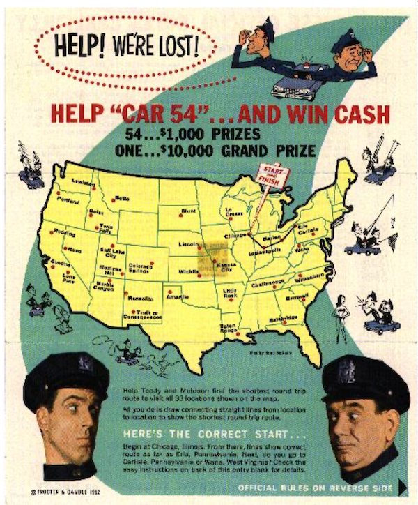
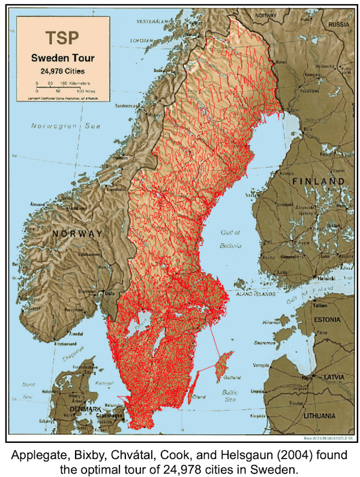
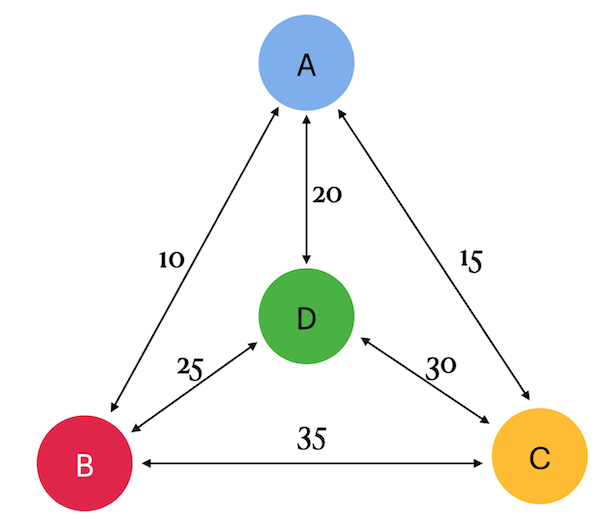

Given a finite number of "cities" and the cost of travel between each pair of cities, find the cheapest way to visit all the cities and return to your starting point. (In the illustration, the Procter & Gamble company held a contest in 1962. The contest required solving a Traveling Salesman Problem (TSP) for a given set of 33 cities. There was a tie among several participants who found the optimal solution. One of the winners was an early TSP researcher, Professor Gerald Thompson from Carnegie Mellon University.)

The travel costs are symmetric in the sense that traveling from city X to city Y costs the same as traveling from city Y to city X. The "way to visit all the cities" refers simply to the order in which the cities are visited. In other words, the data consist of integer weights assigned to the edges of a finite complete graph; the goal is to find a Hamiltonian cycle (i.e., a cycle that visits each vertex exactly once and returns to the starting point) with the minimum total weight. In this context, Hamiltonian cycles are commonly called tours.

The origins of the Traveling Salesman Problem (TSP) are unclear. In the 1920s, mathematician and economist Karl Menger published it among his colleagues in Vienna. In the 1930s, the problem resurfaced in mathematical circles at Princeton. In the 1940s, it was studied by statisticians (Mahalanobis (1940), Jessen (1942), Ghosh (1948), Marks (1948)) in connection with an agricultural application. The mathematician Merrill Flood later popularized it among his colleagues at the RAND Corporation. Eventually, the TSP became known as a prototype of a difficult problem in combinatorial optimization: examining all tours one by one was out of the question due to their vast number, and for a long time, no alternative solution approaches emerged.

## Chapter II
## Rules of the day

- Make sure you are using the latest version of PostgreSQL.
- It is perfectly fine if you use the IDE to write source code (aka SQL script).
- You should not leave any files in your directory other than those explicitly specified by the exercise instructions. It is recommended that you modify your `.gitignore' to avoid accidents. 
- All tasks contain a list of Allowed and Denied sections with listed database options, database types, SQL constructions etc. Please have a look at the section before you start.
- And may the SQL-Force be with you!
- Absolutely anything can be represented in SQL! Let's get started and have fun!

## Chapter III
## Exercise 00 — Classical TSP

| Exercise 00: Classical TSP|                                                                                                                          |
|---------------------------------------|--------------------------------------------------------------------------------------------------------------------------|
| Turn-in directory                     | ex00                                                                                                                     |
| Files to turn-in                      | `team00_ex00.sql` DDL for table creation with INSERTs of data; SQL DML statement                                                                                |
| **Allowed**                               |                                                                                                                          |
| Language                        | ANSI SQL|
| SQL Syntax Pattern                        | Recursive Query|

This is a team project. Take a look at the Graph. 
There are 4 cities (a, b, c and d) and arcs between them with costs (or taxes). Actually, the cost is (a,b) = (b,a).

Please create a table with named nodes using structure {point1, point2, cost} and fill data based on a picture (remember there are direct and reverse paths between 2 nodes).
Please write a SQL statement that returns all tours (aka paths) with minimum travel cost if we start from city "a".
Remember, you need to find the cheapest way to visit all cities and return to your starting point. For example, the tour looks like a -> b -> c -> d -> a.

Below is an example of the output data. Please sort the data by total_cost and then by tour.

| total_cost | tour |
| ------ | ------ |
| 80 | {a,b,d,c,a} |
| ... | ... |

## Exercise 01 — Opposite TSP

| Exercise 01: Opposite TSP|                                                                                                                          |
|---------------------------------------|--------------------------------------------------------------------------------------------------------------------------|
| Turn-in directory                     | ex01                                                                                                                     |
| Files to turn-in                      | `team00_ex01.sql`     SQL DML statement                                                                             |
| **Allowed**                               |                                                                                                                          |
| Language                        | ANSI SQL|
| SQL Syntax Pattern                        | Recursive Query|

Please add a way to see additional rows with the most expensive cost to the SQL from the previous exercise. Take a look at the sample data below. Please sort the data by total_cost and then by tour.

| total_cost | tour |
| ------ | ------ |
| 80 | {a,b,d,c,a} |
| ... | ... |
| 95 | {a,d,c,b,a} |

